# Diyar (دِيار)

An Arabic Android app for discovering destinations across Saudi Arabia, planning a trip day by day, and booking experiences. Made by Hailah Alhejjei for the Smart Devices Programming course (Programming and Web Development diploma, Riyadh).

تطبيق أندرويد عربي لاكتشاف وجهات المملكة، وترتيب الرحلة يوم بيوم، وحجز التجارب. سوّته هيلة الحجي لمادة برمجة الأجهزة الذكية.

  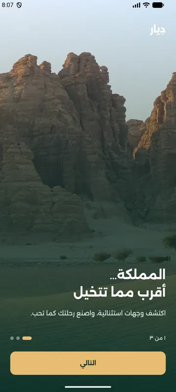
  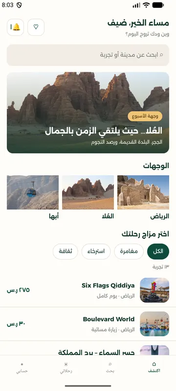
  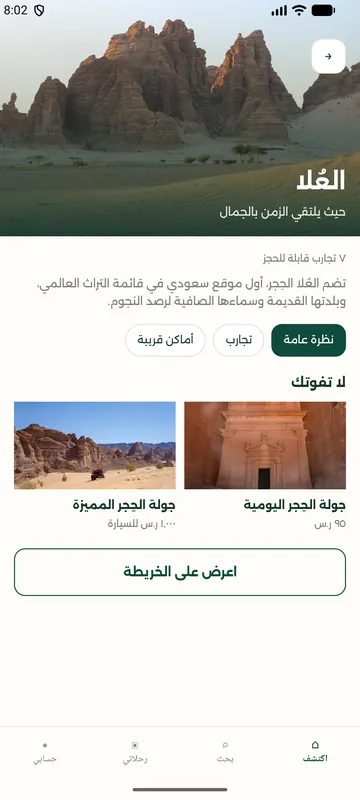
  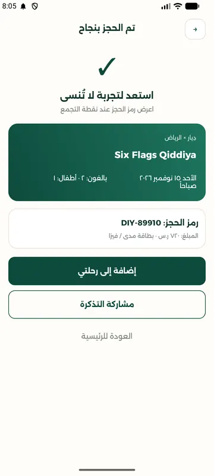

## What it does

- **Onboarding and sign in:** a three-step welcome, then sign in with a phone number or continue as a guest.
- **Discover:** destinations (AlUla, Riyadh, Abha and more), experiences with prices, quick filters, and search.
- **Destination pages:** what to see, nearby places, and a button that opens the location in a maps app.
- **Plan a trip:** save places and add experiences to a day-by-day trip.
- **Book:** choose a date, time and number of adults and children, pay (demo payment, nothing is charged), and get a ticket with a booking code.
- **Notifications:** booking confirmations as system notifications.
- **Profile and settings:** saved places, trips, language and currency.

## Built with

- Java, Android Studio (min SDK 24)
- SQLite for trips and bookings, SharedPreferences for settings
- RecyclerView, ViewPager2, Android notifications

## Screens

| | | | | | |
|---|---|---|---|---|---|
|  | 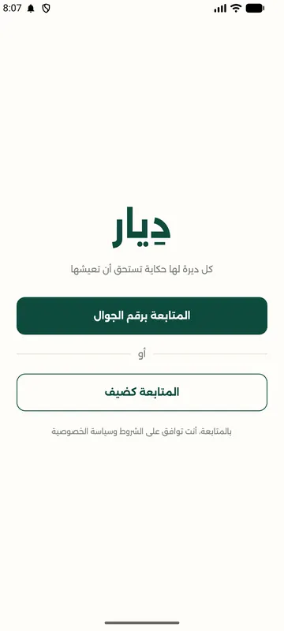 |  | 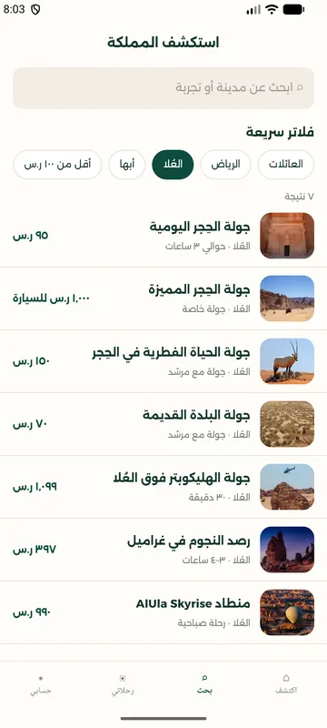 |  | 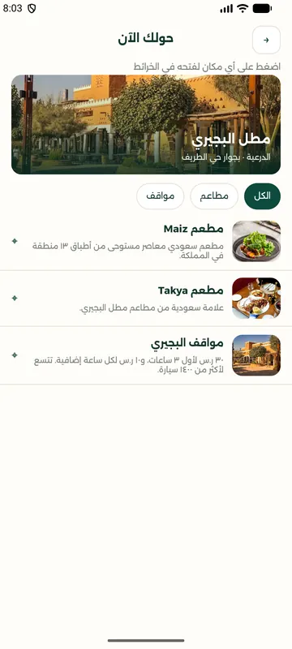 |
| 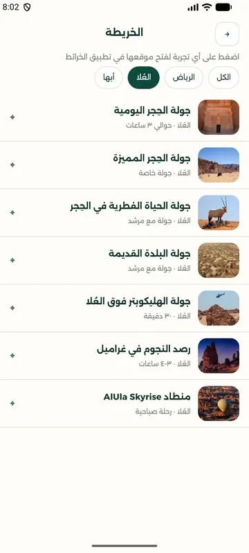 | 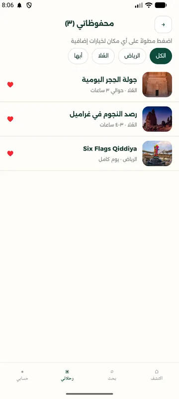 | 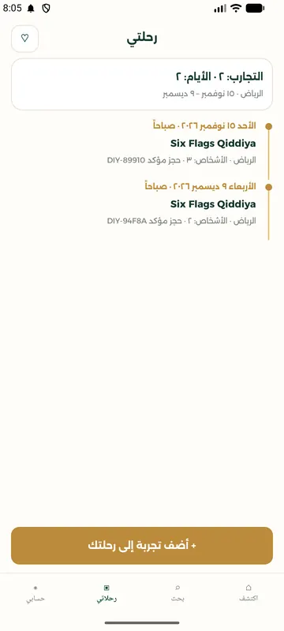 | 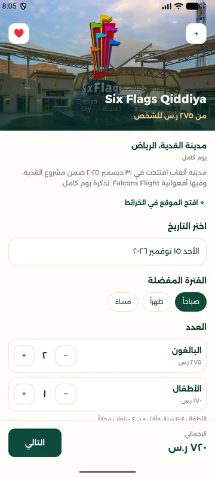 | 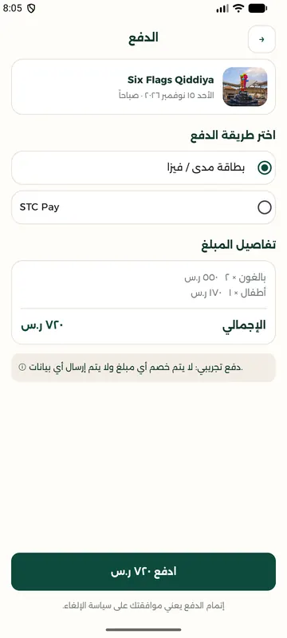 |  |

## Run it

Open the folder in Android Studio and run the `app` configuration on an emulator or a phone.

Portfolio: [hailahalhejjei.github.io](https://hailahalhejjei.github.io)
